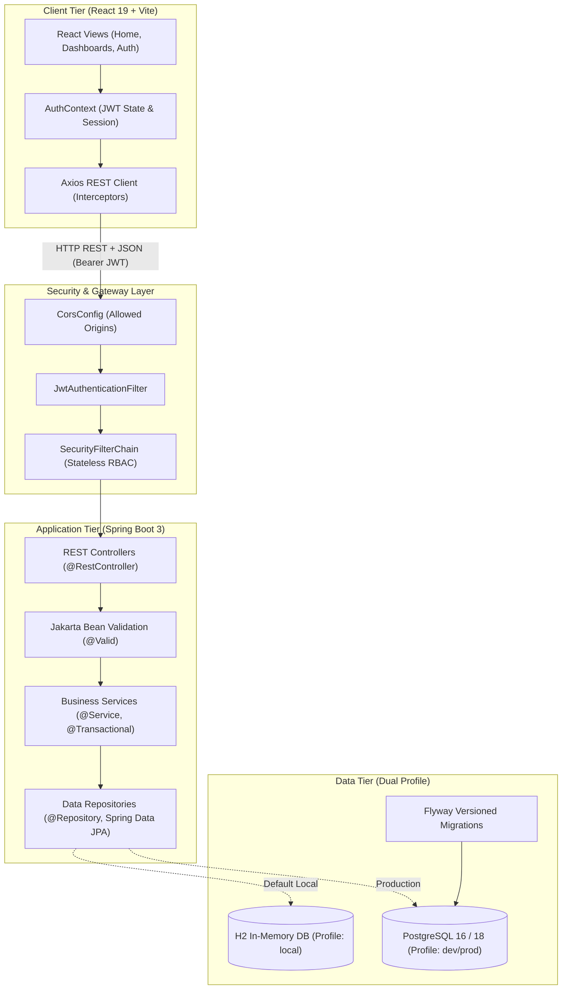
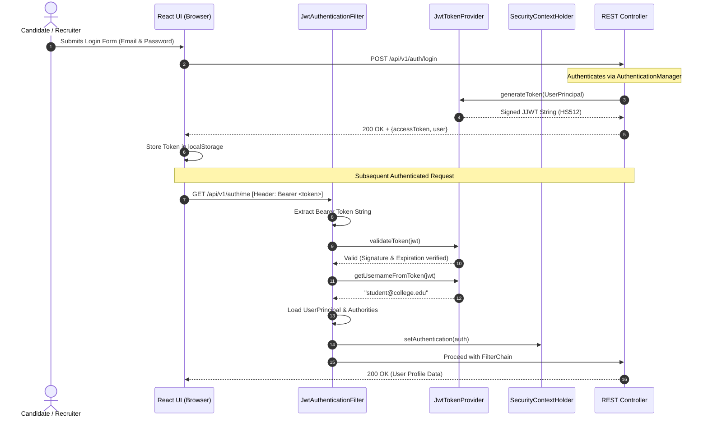
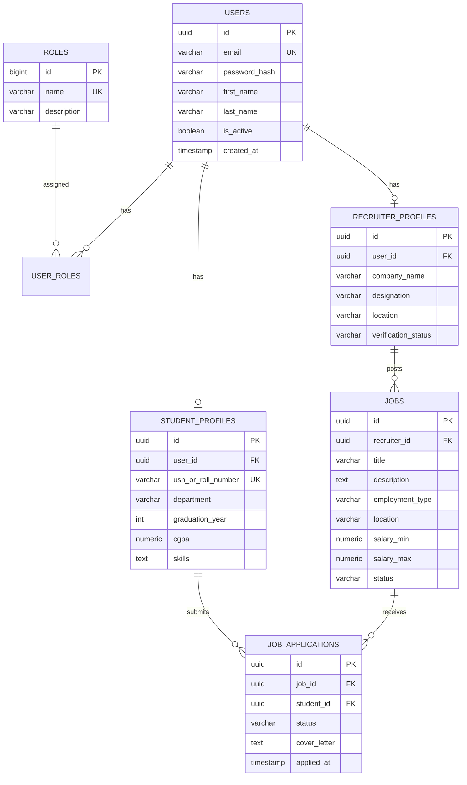

# CareerConnect — Advanced Full-Stack Campus Placement & Job Portal

[](https://spring.io/projects/spring-boot)
[](https://adoptium.net/)
[](https://react.dev/)
[](https://vitejs.dev/)
[](https://www.postgresql.org/)
[](https://jwt.io/)
[]()

> **Final-Year Computer Science & Engineering (CSE) Capstone Project**  
> An enterprise-grade, role-based job portal and campus placement management ecosystem built with Spring Boot 3, Spring Security 6, JWT, Spring Data JPA, Hibernate, PostgreSQL, Flyway, React 19, and Vite.

---

## Table of Contents

1. [Project Overview & Problem Statement](#1-project-overview--problem-statement)
2. [Role Ecosystem & Feature Matrix](#2-role-ecosystem--feature-matrix)
3. [System Architecture & Design Patterns](#3-system-architecture--design-patterns)
4. [Complete Directory Structure & File Map](#4-complete-directory-structure--file-map)
5. [Backend Deep Dive (`careerconnect-api`)](#5-backend-deep-dive-careerconnect-api)
   - [Layered Architecture Breakdown](#51-layered-architecture-breakdown)
   - [Spring Security 6 & JWT 0.12 Lifecycle](#52-spring-security-6--jwt-012-lifecycle)
   - [Entity-Relationship (ER) Schema](#53-entity-relationship-er-schema)
   - [Spring Boot Annotations Cheatsheet](#54-spring-boot-annotations-cheatsheet)
   - [Dual Database Architecture (`local` vs `dev`)](#55-dual-database-architecture-local-vs-dev)
6. [Frontend Deep Dive (`careerconnect-ui`)](#6-frontend-deep-dive-careerconnect-ui)
   - [React 19 + Vite Architecture](#61-react-19--vite-architecture)
   - [State Management & Contexts](#62-state-management--contexts)
   - [Routing & Protected Guards](#63-routing--protected-guards)
   - [Modern Design System & Styling](#64-modern-design-system--styling)
7. [Getting Started & PowerShell Commands](#7-getting-started--powershell-commands)
   - [Prerequisites](#71-prerequisites)
   - [Running Spring Boot Backend](#72-running-spring-boot-backend)
   - [Running React Frontend](#73-running-react-frontend)
   - [Running with Docker Compose](#74-running-with-docker-compose)
   - [Accessing H2 In-Memory Database Web Console](#75-accessing-h2-in-memory-database-web-console)
8. [REST API Documentation & Tested Payloads](#8-rest-api-documentation--tested-payloads)
9. [Pre-Seeded Demo Test Accounts](#9-pre-seeded-demo-test-accounts)
10. [Final-Year CSE Project Viva & Interview Q&A](#10-final-year-cse-project-viva--interview-qa)

---

## 1. Project Overview & Problem Statement

Campus placement drives and corporate graduate hiring processes in universities face distinct operational friction:
- **Disjointed Channels**: Resumes, vacancy announcements, and hiring feedback are scattered across emails, spreadsheets, and messaging groups.
- **Verification Bottlenecks**: Academic scores (CGPA, USN/Roll Numbers) and corporate recruiter identities are hard to audit and moderate.
- **Insecure File Management**: Uploading PDF resumes directly into databases causes bloat, memory leaks, and performance degradation.
- **Authorization Gaps**: Lack of fine-grained Role-Based Access Control (RBAC) allows unauthorized access to applicant records.

**CareerConnect** solves these problems with a unified, cloud-native platform providing:
1. Cryptographically verified role-based access for **Students**, **Recruiters**, and **Placement Cell Admins**.
2. Automated candidate application tracking through customizable hiring stages.
3. Separation of document storage metadata from file assets.
4. Instant live health diagnostics and transparent database migration auditing.

---

## 2. Role Ecosystem & Feature Matrix

| Capability | Student (`ROLE_STUDENT`) | Recruiter (`ROLE_RECRUITER`) | Admin (`ROLE_ADMIN`) |
| :--- | :---: | :---: | :---: |
| **Self-Registration & JWT Login** | ✅ | ✅ | *(Pre-seeded / Managed)* |
| **Academic Profile & CGPA** | ✅ (CRUD) | 👁️ (View Only) | 👁️ (Audit) |
| **Resume Versioning (PDF/DOCX)** | ✅ (Upload/Default) | 👁️ (Download/View) | 👁️ (Audit) |
| **Search & Filter Active Jobs** | ✅ | ✅ | ✅ |
| **1-Click Job Application** | ✅ | ❌ | ❌ |
| **Post & Edit Job Openings** | ❌ | ✅ | ✅ (Moderation) |
| **Candidate Pipeline Tracker** | 👁️ (Own status) | ✅ (Update Status) | 👁️ (Full report) |
| **Corporate Profile Verification** | ❌ | 👁️ (Status view) | ✅ (Approve/Reject) |
| **Campus Placement Analytics** | ❌ | 👁️ (Job stats) | ✅ (Full KPI dashboard) |

---

## 3. System Architecture & Design Patterns

CareerConnect implements an **N-Tier Layered Architecture** on the backend and a **Modular Single-Page Architecture** on the frontend:



### Architectural Principles Enforced:
1. **Layered Separation of Concerns**: Controllers only handle HTTP transport; Services encapsulate business logic and transaction boundaries; Repositories execute database queries.
2. **Zero Entity Leakage**: JPA Entities are never accepted in request bodies or returned in API responses; dedicated Request and Response DTOs enforce data contracts.
3. **Constructor-Based Dependency Injection**: No `@Autowired` on private fields; all classes use final fields and constructor injection for testability and immutability.
4. **Centralized Exception Handling**: A single `@RestControllerAdvice` captures all exceptions, preventing stack trace leakage and ensuring uniform RFC-7807 error JSON.
5. **Stateless Security**: Sessions are completely disabled (`SessionCreationPolicy.STATELESS`); every request is verified purely through its cryptographic JWT token.

---

## 4. Complete Directory Structure & File Map

```text
CareerConnect/
├── .gitignore                                      # Root Git ignore rules (builds, secrets, volumes)
├── docker-compose.yml                              # PostgreSQL 16 + API + React multi-service stack
├── README.md                                       # Master project documentation & developer guide
│
├── database/
│   └── README.md                                   # PostgreSQL setup, psql commands, Flyway guide
│
├── docs/
│   ├── architecture.md                             # Layered N-Tier, JWT security & frontend architecture
│   ├── database-design.md                          # Relational ER diagram, table schemas, indexes & constraints
│   └── api-documentation.md                        # Standard REST API specifications & response payloads
│
├── careerconnect-api/                              # Spring Boot 3 REST Backend
│   ├── pom.xml                                     # Maven dependencies (JPA, Security, JJWT, Flyway, H2, PostgreSQL)
│   ├── Dockerfile                                  # Multi-stage production container build (Temurin Alpine)
│   ├── .env.example                                # Backend environment configuration template
│   ├── mvnw / mvnw.cmd                             # Maven wrapper scripts (Windows & Linux)
│   ├── .mvn/wrapper/
│   │   └── maven-wrapper.properties                # Wrapper runtime configuration (Maven 3.9.9)
│   └── src/
│       ├── main/
│       │   ├── java/com/careerconnect/
│       │   │   ├── CareerConnectApplication.java   # Spring Boot entry point with startup diagnostics
│       │   │   ├── config/
│       │   │   │   ├── SecurityConfig.java         # Spring Security 6 stateless filter chain & RBAC
│       │   │   │   ├── CorsConfig.java             # CORS configuration bean for frontend origins
│       │   │   │   └── DataInitializer.java        # Startup CommandLineRunner seeding roles, demo users & sample jobs
│       │   │   ├── controller/
│       │   │   │   ├── AuthController.java         # REST endpoints for login, register, and /auth/me
│       │   │   │   ├── JobController.java          # REST endpoints for paginated job search & job details
│       │   │   │   └── HealthController.java       # Public API health check (/api/v1/health)
│       │   │   ├── service/
│       │   │   │   ├── AuthService.java            # Authentication service interface
│       │   │   │   ├── JobService.java             # Job management service interface
│       │   │   │   └── impl/
│       │   │   │       ├── AuthServiceImpl.java    # BCrypt hashing, JWT generation & profile provisioning
│       │   │   │       └── JobServiceImpl.java     # Paginated job query execution & DTO conversion
│       │   │   ├── repository/
│       │   │   │   ├── UserRepository.java         # User persistence (findByEmail, existsByEmail)
│       │   │   │   ├── RoleRepository.java         # Role persistence (findByName)
│       │   │   │   ├── StudentProfileRepository.java# Student profiles by user ID & roll number
│       │   │   │   ├── RecruiterProfileRepository.java # Recruiter profiles by user ID
│       │   │   │   ├── JobRepository.java          # Paginated job queries by status & recruiter
│       │   │   │   └── JobApplicationRepository.java# Application submissions & duplicate prevention
│       │   │   ├── entity/
│       │   │   │   ├── User.java                   # Core credentials entity (@Table users)
│       │   │   │   ├── Role.java                   # Security roles (@Table roles)
│       │   │   │   ├── StudentProfile.java         # Student academic info (@Table student_profiles)
│       │   │   │   ├── RecruiterProfile.java       # Company & HR info (@Table recruiter_profiles)
│       │   │   │   ├── Job.java                    # Job vacancy postings (@Table jobs)
│       │   │   │   └── JobApplication.java         # Candidate submissions (@Table job_applications)
│       │   │   ├── dto/
│       │   │   │   ├── request/
│       │   │   │   │   ├── LoginRequest.java       # Validated login credentials payload
│       │   │   │   │   └── RegisterRequest.java    # Validated registration payload
│       │   │   │   └── response/
│       │   │   │       ├── ApiResponse.java        # Standardized generic envelope <T>
│       │   │   │       ├── AuthResponse.java       # JWT token, expiration, and user summary
│       │   │   │       ├── UserSummaryResponse.java# Safe client-facing user information
│       │   │   │       ├── JobResponse.java        # Sanitized job opening response
│       │   │   │       ├── ErrorResponse.java      # Standard RFC-7807 error payload
│       │   │   │       └── HealthResponse.java     # Health & environment diagnostic payload
│       │   │   ├── security/
│       │   │   │   ├── JwtTokenProvider.java       # JJWT 0.12 token generation, signing & verification
│       │   │   │   ├── JwtAuthenticationFilter.java# OncePerRequestFilter checking Bearer tokens
│       │   │   │   ├── UserPrincipal.java          # Spring Security UserDetails implementation
│       │   │   │   └── CustomUserDetailsService.java# Database-backed user details loader
│       │   │   ├── exception/
│       │   │   │   ├── GlobalExceptionHandler.java # Centralized @RestControllerAdvice exception handler
│       │   │   │   ├── ResourceNotFoundException.java # HTTP 404 mapped exception
│       │   │   │   └── BadRequestException.java    # HTTP 400 mapped exception
│       │   │   └── util/
│       │   │       └── AppConstants.java           # Global constants (pagination, roles, API prefixes)
│       │   └── resources/
│       │       ├── application.properties          # Base properties with .env fallback placeholders
│       │       ├── application-local.properties    # In-memory H2 profile with /h2-console enabled
│       │       ├── application-dev.properties      # PostgreSQL development profile with SQL logging
│       │       └── db/migration/
│       │           └── V1__init_schema.sql         # Flyway initial schema (PostgreSQL 16 relational DDL)
│       └── test/java/com/careerconnect/
│           └── CareerConnectApplicationTests.java  # Application initialization unit test
│
└── careerconnect-ui/                               # React + Vite Frontend
    ├── package.json                                # React 19, React Router 7, Axios, Lucide React
    ├── vite.config.js                              # Vite dev server (port 5173) + /api reverse proxy
    ├── index.html                                  # HTML5 entry with Google Fonts (Plus Jakarta Sans, Outfit)
    ├── Dockerfile                                  # Multi-stage production container build (Nginx Alpine)
    ├── .env.example                                # Frontend environment template
    ├── public/                                     # Favicon and SVG assets
    └── src/
        ├── main.jsx                                # React DOM entry point
        ├── App.jsx                                 # Root component (BrowserRouter + AuthProvider + Layout)
        ├── assets/                                 # Brand images and SVG icons
        ├── styles/
        │   ├── index.css                           # Design system variables, buttons, badges, glassmorphism
        │   └── App.css                             # Layout, navbar, cards, footer, dashboards styling
        ├── utils/
        │   └── tokenHelper.js                      # LocalStorage token & user session management
        ├── services/
        │   ├── api.js                              # Centralized Axios instance with request/response interceptors
        │   ├── authService.js                      # Authentication REST endpoints
        │   └── jobService.js                       # Job listings & health check REST calls
        ├── context/
        │   ├── authContextDef.js                   # Decoupled React Context definition (Fast Refresh safe)
        │   └── AuthContext.jsx                     # Global auth state, login/register/logout methods, RBAC
        ├── hooks/
        │   └── useAuth.js                          # Custom hook for consuming AuthContext
        ├── components/
        │   ├── common/
        │   │   ├── Navbar.jsx                      # Navigation bar with role-aware menu links & auth state
        │   │   ├── Footer.jsx                      # Footer with documentation links
        │   │   ├── Button.jsx                      # Reusable button component (primary, secondary, outline)
        │   │   ├── Card.jsx                        # Glassmorphism container component
        │   │   └── Badge.jsx                       # Role and status badge component
        │   └── layout/
        │       └── MainLayout.jsx                  # Layout wrapper with sticky navbar and footer
        ├── routes/
        │   ├── AppRoutes.jsx                       # Route registry (public + protected role views + 404)
        │   └── ProtectedRoute.jsx                  # Role-aware route guard
        └── pages/
            ├── Home.jsx                            # Landing page with live backend health check & role cards
            ├── NotFound.jsx                        # 404 page
            ├── auth/
            │   ├── Login.jsx                       # Sign-in page with quick-fill demo role credentials
            │   └── Register.jsx                    # Multi-role registration (Student / Recruiter)
            ├── student/
            │   └── StudentDashboard.jsx            # Student portal overview & resume manager
            ├── recruiter/
            │   └── RecruiterDashboard.jsx          # Recruiter workspace & job applicant pipeline
            └── admin/
                └── AdminDashboard.jsx              # Admin governance & recruiter verification queue
```

---

## 5. Backend Deep Dive (`careerconnect-api`)

### 5.1. Layered Architecture Breakdown

Each layer has a single, strictly defined responsibility:

1. **Entity Layer (`com.careerconnect.entity`)**:
   - Maps Java classes directly to relational tables using JPA annotations (`@Entity`, `@Table`, `@Id`, `@Column`, `@ManyToOne`, `@ManyToMany`).
   - Uses UUIDs as primary keys to prevent enumeration attacks.
   - Automatically maintains audit timestamps (`@PreUpdate`, `createdAt`, `updatedAt`).
2. **Repository Layer (`com.careerconnect.repository`)**:
   - Interfaces extending `JpaRepository<Entity, ID>`.
   - Generates SQL queries automatically at runtime based on method names (e.g., `findByEmail`, `existsByEmail`, `findByStatus`).
   - Supports paginated and sorted queries via `Pageable`.
3. **Service Layer (`com.careerconnect.service`)**:
   - Declares domain business logic contracts in interfaces and implements them in `service.impl.*`.
   - Annotated with `@Transactional` to guarantee database atomicity (automatic rollback on unhandled exceptions).
   - Coordinates BCrypt password hashing, JWT token generation, role mapping, and profile provisioning.
4. **Controller Layer (`com.careerconnect.controller`)**:
   - Exposes RESTful endpoints using `@RestController` and `@RequestMapping("/api/v1/...")`.
   - Validates incoming DTOs using `@Valid`.
   - Wraps all return values in a standardized `ResponseEntity<ApiResponse<T>>`.
5. **Centralized Exception Handler (`com.careerconnect.exception.GlobalExceptionHandler`)**:
   - Uses `@RestControllerAdvice` to intercept exceptions across the entire application.
   - Converts validation failures (`MethodArgumentNotValidException`) into structured field-by-field error reports.
   - Formats 404 (`ResourceNotFoundException`), 400 (`BadRequestException`), 401 (`BadCredentialsException`), and 403 (`AccessDeniedException`) responses uniformly.

---

### 5.2. Spring Security 6 & JWT 0.12 Lifecycle



---

### 5.3. Entity-Relationship (ER) Schema



---

### 5.4. Spring Boot Annotations Cheatsheet

| Annotation | Category | Real Example in Project | Explanation |
| :--- | :--- | :--- | :--- |
| `@SpringBootApplication` | Core | `CareerConnectApplication` | Master annotation combining `@Configuration`, `@EnableAutoConfiguration`, and `@ComponentScan`. |
| `@RestController` | Web | `AuthController`, `JobController` | Marks a class as an HTTP API handler; automatically serializes method return values to JSON. |
| `@RequestMapping` | Web | `@RequestMapping("/api/v1/auth")` | Sets the base URL path prefix for all endpoints inside the controller class. |
| `@GetMapping` / `@PostMapping` | Web | `@PostMapping("/login")` | Maps specific HTTP verbs (GET, POST, PUT, DELETE) to a Java method. |
| `@RequestBody` | Web | `login(@RequestBody LoginRequest req)` | Deserializes the incoming JSON request body into a strongly typed Java DTO. |
| `@PathVariable` | Web | `@GetMapping("/{id}")` | Extracts dynamic variables directly from the URI path (e.g., UUID from `/jobs/{id}`). |
| `@RequestParam` | Web | `@RequestParam(defaultValue = "0") int page` | Extracts URL query parameters (e.g., `?page=0&size=10`). |
| `@Valid` | Validation | `@Valid @RequestBody RegisterRequest req` | Triggers Jakarta Bean Validation constraints (`@NotBlank`, `@Email`, `@Size`) before running logic. |
| `@Service` | Service | `AuthServiceImpl`, `JobServiceImpl` | Marks a class as containing business logic and registers it as an injectable Spring Bean. |
| `@Transactional` | Database | `@Transactional public UserSummaryResponse register(...)` | Ensures database atomicity; automatically rolls back changes if an unhandled exception occurs. |
| `@Repository` | Database | `UserRepository`, `JobRepository` | Marks Spring Data JPA interfaces; Spring automatically generates SQL implementations at startup. |
| `@Entity` & `@Table` | Persistence | `User`, `Job`, `Role` | Maps a Java class to a relational database table. |
| `@Id` & `@GeneratedValue` | Persistence | `@GeneratedValue(strategy = GenerationType.UUID)` | Designates the primary key field and specifies its generation algorithm. |
| `@ManyToOne` / `@ManyToMany` | Relationships | `@ManyToOne(fetch = FetchType.EAGER)` | Establishes relational foreign key relationships between entities. |
| `@RestControllerAdvice` | Diagnostics | `GlobalExceptionHandler` | Global interceptor capturing exceptions thrown by controllers to return uniform error responses. |
| `@ExceptionHandler` | Diagnostics | `@ExceptionHandler(ResourceNotFoundException.class)` | Specifies which exact Java exception class a handler method will process. |

---

### 5.5. Dual Database Architecture (`local` vs `dev`)

CareerConnect features an enterprise dual-profile persistence strategy:

1. **Profile `local` (Default)**:
   - Uses an in-memory **H2 database** with PostgreSQL syntax emulation.
   - Hibernate automatically builds and updates the schema on startup (`ddl-auto=update`).
   - Seeds demo accounts and job vacancies via `DataInitializer.java`.
   - Provides an interactive web GUI console at `http://localhost:8080/h2-console`.
   - **Advantage**: Zero configuration; anyone can clone and run the project immediately without installing PostgreSQL.
2. **Profile `dev` / `prod`**:
   - Connects to an external **PostgreSQL 16 / 18** database instance.
   - Flyway executes versioned SQL migrations (`V1__init_schema.sql`) for strict schema version control.
   - Reads database credentials securely from your `.env` file.

---

## 6. Frontend Deep Dive (`careerconnect-ui`)

### 6.1. React 19 + Vite Architecture

- **React 19**: Modern concurrent React leveraging functional components, hooks, and clean state primitives.
- **Vite 6**: Rollup-powered build tool providing instantaneous Hot Module Replacement (HMR) and optimized ES module bundling.
- **Decoupled Context Pattern**: Context definitions are placed in plain `.js` files (`src/context/authContextDef.js`) to completely isolate them from JSX Fast Refresh transformations, ensuring zero runtime reload errors.

### 6.2. State Management & Contexts

The `AuthContext` provides global authentication state across the entire component tree:
- **`user`**: The currently authenticated user object (`id`, `email`, `firstName`, `lastName`, `roles`).
- **`token`**: The active JWT access token (persisted in `localStorage`).
- **`isAuthenticated`**: Boolean flag indicating valid login state.
- **`hasRole(roleName)`**: Role validation helper (e.g., `hasRole('STUDENT')` or `hasRole('RECRUITER')`).
- **`login(credentials)`** / **`register(data)`** / **`logout()`**: Authentication lifecycle actions.

### 6.3. Routing & Protected Guards

Routes are declared in [AppRoutes.jsx](file:///c:/Users/srinath/Downloads/CareerConnect/careerconnect-ui/src/routes/AppRoutes.jsx) and guarded with [ProtectedRoute.jsx](file:///c:/Users/srinath/Downloads/CareerConnect/careerconnect-ui/src/routes/ProtectedRoute.jsx):
- **Public Routes**: `/` (Home), `/jobs` (Job Listings), `/login`, `/register`.
- **Student Guard**: `/student/dashboard` requires `requiredRole="STUDENT"`.
- **Recruiter Guard**: `/recruiter/dashboard` requires `requiredRole="RECRUITER"`.
- **Admin Guard**: `/admin/dashboard` requires `requiredRole="ADMIN"`.
- If an unauthenticated user accesses a protected route, they are automatically redirected to `/login` with their return path saved in `location.state`.

### 6.4. Modern Design System & Styling

Defined centrally in [index.css](file:///c:/Users/srinath/Downloads/CareerConnect/careerconnect-ui/src/styles/index.css) without third-party CSS dependencies:
- **Color Tokens**: Rich Indigo primary palette (`--primary-50` to `--primary-900`) combined with deep Slate surfaces (`--bg-main: #0b0f19`, `--bg-card: rgba(17, 24, 39, 0.75)`).
- **Glassmorphism**: `.glass-panel` utility with `backdrop-filter: blur(16px)` and subtle glowing border highlights.
- **Micro-Animations**: Pulsing live health status indicators (`@keyframes pulseDot`), smooth button translations, and reactive hover cards.
- **Modern Typography**: Google Fonts (`Plus Jakarta Sans` for body text and `Outfit` for display headings).

---

## 7. Getting Started & PowerShell Commands

### 7.1. Prerequisites

Verify installed tools in Windows PowerShell:
```powershell
java -version    # OpenJDK 17 or 21
mvn -version     # Apache Maven 3.9+ (or use included mvnw.cmd)
node -v          # Node.js 18+
npm -v           # npm 9+
```

---

### 7.2. Running Spring Boot Backend

#### Step 1: Open PowerShell Terminal 1
```powershell
cd c:\Users\srinath\Downloads\CareerConnect\careerconnect-api
```

#### Step 2: Run with In-Memory Database (Quick Start)
```powershell
mvn spring-boot:run
```
*(Or use the Windows Maven wrapper: `./mvnw.cmd spring-boot:run`)*

The application will start, create all tables in H2, seed default test accounts, and listen on **`http://localhost:8080`**.

#### Step 3: Run with PostgreSQL (When PostgreSQL is running)
```powershell
# Set profile to dev and supply your PostgreSQL credentials
$env:SPRING_PROFILES_ACTIVE="dev"
$env:DB_USERNAME="careerconnect_user"
$env:DB_PASSWORD="careerconnect_secure_password_2026"

mvn spring-boot:run
```

---

### 7.3. Running React Frontend

#### Step 1: Open PowerShell Terminal 2
```powershell
cd c:\Users\srinath\Downloads\CareerConnect\careerconnect-ui
```

#### Step 2: Install Dependencies (First time only)
```powershell
npm install
```

#### Step 3: Start Vite Development Server
```powershell
npm run dev
```

Open your browser and navigate to: **[http://localhost:5173](http://localhost:5173)**.  
The landing page will immediately check and display the live status of the Spring Boot backend!

---

### 7.4. Running with Docker Compose

To run the entire full-stack ecosystem (PostgreSQL 16 + Spring Boot + React) with one command:

```powershell
cd c:\Users\srinath\Downloads\CareerConnect
docker compose up -d
```

- **Frontend**: [http://localhost:5173](http://localhost:5173)
- **Backend API**: [http://localhost:8080/api/v1](http://localhost:8080/api/v1)
- **Actuator Health**: [http://localhost:8080/actuator/health](http://localhost:8080/actuator/health)
- **PostgreSQL**: `localhost:5432` (`careerconnect_db`)

---

### 7.5. Accessing H2 In-Memory Database Web Console

When running in `local` profile, inspect tables directly in your browser:

1. Open **[http://localhost:8080/h2-console](http://localhost:8080/h2-console)**
2. Set the connection parameters:
   - **JDBC URL**: `jdbc:h2:mem:careerconnect_db`
   - **User Name**: `sa`
   - **Password**: *(leave blank)*
3. Click **Connect** to query `USERS`, `ROLES`, `JOBS`, and `STUDENT_PROFILES` live!

---

## 8. REST API Documentation & Tested Payloads

All endpoints are namespaced under `/api/v1`.

### 8.1. System & Diagnostics
| Method | Endpoint | Access | Description |
| :--- | :--- | :--- | :--- |
| `GET` | `/api/v1/health` | Public | Returns service health, version, JVM runtime, and active profile. |
| `GET` | `/actuator/health` | Public | Spring Boot Actuator component status. |

---

### 8.2. Authentication (`/api/v1/auth`)
| Method | Endpoint | Access | Request Body | Description |
| :--- | :--- | :--- | :--- | :--- |
| `POST` | `/api/v1/auth/register` | Public | `RegisterRequest` | Registers a new Student or Recruiter account. |
| `POST` | `/api/v1/auth/login` | Public | `LoginRequest` | Verifies credentials with BCrypt; returns JWT access token. |
| `GET` | `/api/v1/auth/me` | Authenticated | *(Bearer Token)* | Returns current authenticated user principal details. |

#### Sample Login Request (PowerShell):
```powershell
$body = @{
    email = "student@college.edu"
    password = "Password@123"
} | ConvertTo-Json

Invoke-RestMethod -Uri "http://localhost:8080/api/v1/auth/login" -Method Post -ContentType "application/json" -Body $body | ConvertTo-Json -Depth 5
```

---

### 8.3. Job Opportunities (`/api/v1/jobs`)
| Method | Endpoint | Access | Query Params | Description |
| :--- | :--- | :--- | :--- | :--- |
| `GET` | `/api/v1/jobs` | Public | `page` (default: 0), `size` (default: 10) | Paginated list of active campus job openings. |
| `GET` | `/api/v1/jobs/{id}` | Public | *(Job UUID)* | Detailed view of a single job opening. |

#### Sample Fetch Jobs (PowerShell):
```powershell
Invoke-RestMethod -Uri "http://localhost:8080/api/v1/jobs" | ConvertTo-Json -Depth 5
```

---

## 9. Pre-Seeded Demo Test Accounts

These accounts are automatically provisioned on startup by `DataInitializer.java`:

| Role | Email | Password | Primary Workspace |
| :--- | :--- | :--- | :--- |
| **Student** | `student@college.edu` | `Password@123` | Student Dashboard (`/student/dashboard`) |
| **Recruiter** | `recruiter@techcorp.com` | `Password@123` | Recruiter Dashboard (`/recruiter/dashboard`) |
| **Admin** | `admin@careerconnect.org` | `Password@123` | Admin Console (`/admin/dashboard`) |

---

## 10. Final-Year CSE Project Viva & Interview Q&A

Use these questions and answers to prepare for project defense and technical interviews:

### Q1: Why did you choose Spring Boot over standard Java Servlets or plain Spring Framework?
**Answer**: Plain Java Servlets require manual request parsing, thread management, and web server configuration. Plain Spring Framework requires extensive XML/Java configuration for DispatcherServlets and ViewResolvers. **Spring Boot** provides opinionated auto-configuration, an embedded Tomcat web server, production-ready metrics via Actuator, and starter dependencies (`spring-boot-starter-web`, `spring-boot-starter-data-jpa`) that cut boilerplate code by over 70%.

### Q2: How does Spring Security authenticate requests statelessly with JWT?
**Answer**: Traditional stateful security creates an HTTP session on the server and stores a session ID in a browser cookie. This does not scale horizontally across multiple microservices. In CareerConnect, we configure `SessionCreationPolicy.STATELESS`. When a user logs in, the server generates a cryptographically signed JSON Web Token (JJWT) containing the user's ID, email, and roles. The client sends this token in the `Authorization: Bearer <token>` header of every request. Our custom `JwtAuthenticationFilter` intercepts the request, verifies the HMAC-SHA signature using a 256-bit secret key, parses the claims, and populates the `SecurityContextHolder`.

### Q3: What is the difference between Hibernate and Spring Data JPA?
**Answer**: 
- **JPA (Jakarta Persistence API)** is a Java specification that defines standard interfaces and annotations for Object-Relational Mapping (ORM).
- **Hibernate** is the actual ORM engine that implements the JPA specification, generating SQL queries and managing the second-level cache.
- **Spring Data JPA** is an abstraction layer built on top of JPA. It eliminates boilerplate DAO code by allowing us to declare interfaces like `UserRepository extends JpaRepository<User, UUID>` where Spring automatically provides CRUD, pagination, and derived query methods at runtime.

### Q4: Why shouldn't we return JPA Entities directly from REST Controllers?
**Answer**:
1. **Security & Sensitive Data Exposure**: Entities contain fields like `passwordHash` or internal audit flags. Exposing them leaks sensitive information.
2. **Infinite Recursion**: Bidirectional JPA relationships (e.g., `@OneToMany` and `@ManyToOne`) cause Jackson serialization to enter infinite loops, triggering `StackOverflowError`.
3. **Over-Posting Attacks**: Malicious users could send extra JSON properties that bind directly to entity fields, overwriting admin privileges.
4. **API Version Stability**: Changes to the database schema would immediately break client applications. DTOs decouple internal database structure from the public API contract.

### Q5: How do you handle database migrations between local development and production?
**Answer**: We use **Flyway**. Schema changes are written as versioned SQL scripts (e.g., `V1__init_schema.sql`) in `src/main/resources/db/migration`. When Spring Boot starts, Flyway inspects the `flyway_schema_history` table in PostgreSQL, identifies unapplied migrations, and executes them in strict sequence within transactions. In our `local` profile, we leverage in-memory H2 with Hibernate DDL generation for rapid development without external database dependencies.
