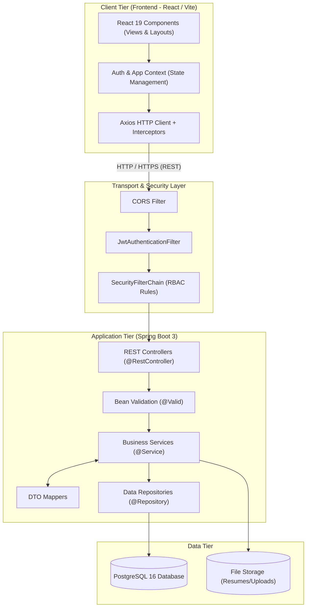
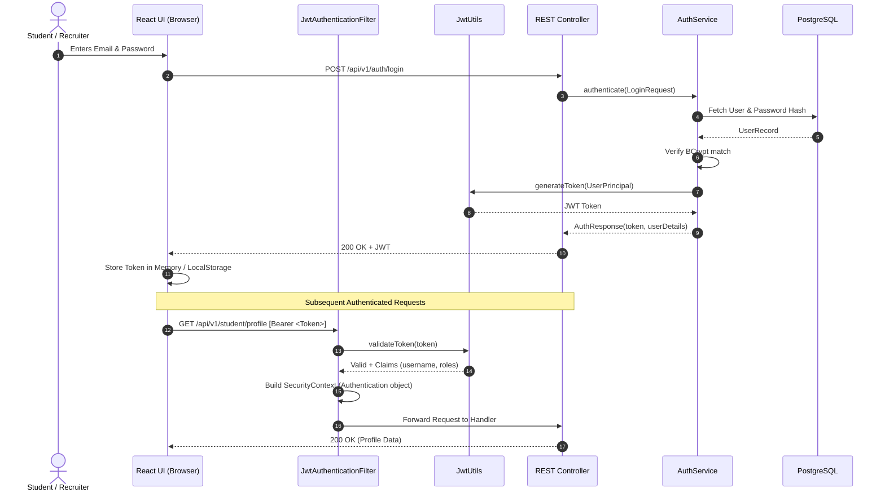

# CareerConnect — Architecture Specification

This document details the architectural design, security mechanisms, structural conventions, and data flows of the **CareerConnect** platform.

---

## 1. High-Level Architectural Pattern

CareerConnect follows an industry-standard **N-Tier Layered Architecture** on the backend and a **Component-Based Modular Architecture** on the frontend.

---

## 2. Backend Layer Responsibilities

### 2.1. Controller Layer (`com.careerconnect.controller`)
- Exposes standardized RESTful endpoints under `/api/v1/`.
- Never contains business rules or direct SQL queries.
- Injects Request DTOs with `@Valid` for automatic payload validation.
- Returns standardized `ResponseEntity<ApiResponse<T>>` objects.

### 2.2. Service Layer (`com.careerconnect.service`)
- Enforces all business logic, validation rules, and role checks.
- Annotated with `@Transactional` for atomic operations requiring rollback on runtime exceptions.
- Converts between database Entities and DTOs using dedicated mappers.
- Constructor-based dependency injection is used exclusively across all services (no field injection `@Autowired`).

### 2.3. Repository Layer (`com.careerconnect.repository`)
- Extends Spring Data JPA's `JpaRepository<Entity, ID>` and `JpaSpecificationExecutor<Entity>` for dynamic filtering and pagination.
- Leverages derived query methods and optimized `@Query` JPQL queries to avoid N+1 select problems.

### 2.4. Data Transfer Objects (`com.careerconnect.dto`)
- **Request DTOs**: Tailored to specific incoming actions (e.g., `RegisterRequest`, `JobCreateRequest`, `ApplicationStatusUpdateRequest`). Contains Jakarta validation constraints (`@NotBlank`, `@Email`, `@Min`, `@Pattern`).
- **Response DTOs**: Tailored for consumption by the UI (e.g., `JobResponse`, `StudentProfileResponse`, `AuthResponse`). Sensitive fields (passwords, internal IDs, audit flags) are stripped before sending.

### 2.5. Centralized Exception Handling (`com.careerconnect.exception`)
- A global `@RestControllerAdvice` captures:
  - `MethodArgumentNotValidException` (400 Bad Request with field-level errors)
  - `ResourceNotFoundException` (404 Not Found)
  - `BadCredentialsException` / `AccessDeniedException` (401 / 403 Forbidden)
  - Unhandled exceptions (500 Internal Server Error with sanitized error response)

---

## 3. Security & Authentication Architecture

### Security Principles
1. **Stateless Session Management**: Spring Security is configured with `SessionCreationPolicy.STATELESS`. No server-side HTTP session cookies are created.
2. **Password Cryptography**: Passwords are encrypted using BCrypt with a default work factor of 12.
3. **Role-Based Access Control (RBAC)**:
   - `ROLE_STUDENT`: Access to student profile, job search, job applications.
   - `ROLE_RECRUITER`: Access to company profile, job posting CRUD, applicant review.
   - `ROLE_ADMIN`: Access to user management, recruiter verification, audit analytics.
4. **CORS Policy**: Configured explicitly for frontend origins (e.g., `http://localhost:5173`) with explicit allowed HTTP methods (`GET`, `POST`, `PUT`, `DELETE`, `PATCH`, `OPTIONS`) and headers.

---

## 4. Frontend Architecture

### 4.1. State Management & Context
- **AuthContext**: Manages active user authentication state, token persistence, current user roles, and login/logout lifecycle.
- **Axios Interceptors**:
  - Request interceptor automatically attaches the `Authorization: Bearer <token>` header to all outgoing requests.
  - Response interceptor traps `401 Unauthorized` responses to clear invalid tokens and redirect to `/login`.

### 4.2. Routing & Route Guards
- `AppRoutes.jsx` renders routes through a `ProtectedRoute` wrapper checking authentication and required role access.
- Unauthorized users attempting to view recruiter or admin pages are gracefully redirected to appropriate unauthorized/login views.

---

## 5. Storage Architecture for Resumes
- Resumes uploaded by students are stored on the local file system (or object storage in production), defined by `app.file-upload.dir`.
- The database stores only the metadata (`file_name`, `original_name`, `file_size`, `content_type`, `storage_path`, `upload_timestamp`).
- This prevents database bloat, ensures high throughput, and enables streaming file downloads.
