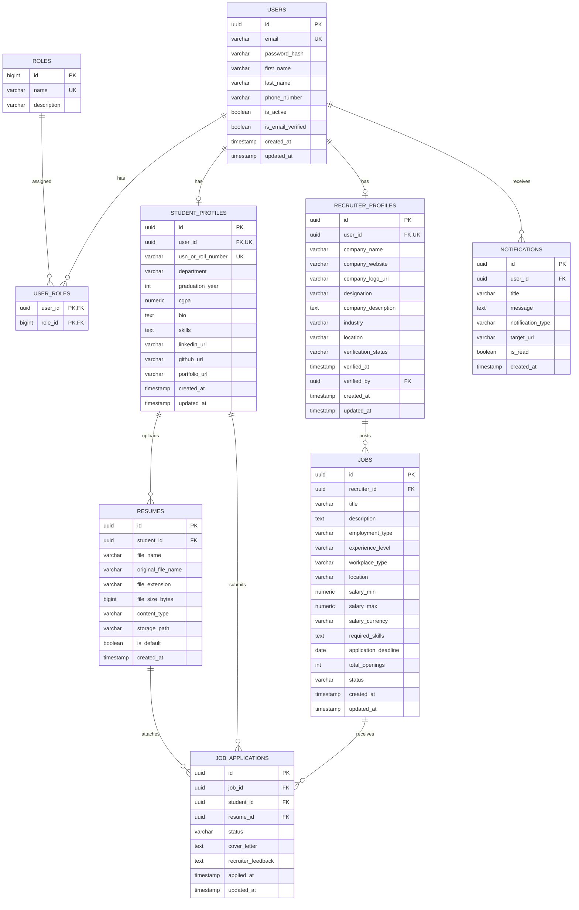

# CareerConnect — Database Design & Schema Specification

This document defines the relational database architecture for **CareerConnect**, managed with PostgreSQL 16 and versioned via Flyway migrations.

---

## 1. Entity-Relationship (ER) Diagram

---

## 2. Table Specifications & Constraints

### 2.1. `users`
Central user registry for all authentication principals across all roles.
- `id`: UUID (Primary Key, default `gen_random_uuid()`)
- `email`: VARCHAR(255) NOT NULL, UNIQUE (Indexed)
- `password_hash`: VARCHAR(255) NOT NULL
- `first_name`: VARCHAR(100) NOT NULL
- `last_name`: VARCHAR(100) NOT NULL
- `phone_number`: VARCHAR(20)
- `is_active`: BOOLEAN DEFAULT true NOT NULL
- `is_email_verified`: BOOLEAN DEFAULT false NOT NULL
- `created_at`: TIMESTAMP WITH TIME ZONE DEFAULT CURRENT_TIMESTAMP NOT NULL
- `updated_at`: TIMESTAMP WITH TIME ZONE DEFAULT CURRENT_TIMESTAMP NOT NULL

### 2.2. `roles` & `user_roles`
Normalized Role-Based Access Control mapping.
- Pre-seeded roles: `ROLE_STUDENT`, `ROLE_RECRUITER`, `ROLE_ADMIN`.
- Many-to-many relationship via `user_roles(user_id, role_id)`.

### 2.3. `student_profiles`
Holds academic, skill, and placement data for candidates.
- `id`: UUID Primary Key
- `user_id`: UUID NOT NULL UNIQUE, Foreign Key to `users(id)` ON DELETE CASCADE
- `usn_or_roll_number`: VARCHAR(50) UNIQUE NOT NULL (Indexed)
- `department`: VARCHAR(100) NOT NULL (e.g., Computer Science, Information Science)
- `graduation_year`: INT NOT NULL
- `cgpa`: NUMERIC(4, 2) NOT NULL (Check: `cgpa >= 0.0 AND cgpa <= 10.0`)
- `skills`: TEXT (Comma-separated or JSON list of technologies)
- `linkedin_url`, `github_url`, `portfolio_url`: VARCHAR(255)

### 2.4. `recruiter_profiles`
Maintains verified corporate presence and recruiter contact metadata.
- `id`: UUID Primary Key
- `user_id`: UUID NOT NULL UNIQUE, Foreign Key to `users(id)` ON DELETE CASCADE
- `company_name`: VARCHAR(200) NOT NULL (Indexed)
- `company_website`: VARCHAR(255)
- `designation`: VARCHAR(100) NOT NULL (e.g., HR Lead, University Recruiter)
- `verification_status`: VARCHAR(30) DEFAULT 'PENDING' NOT NULL (Check: `PENDING`, `VERIFIED`, `REJECTED`)
- `verified_at`: TIMESTAMP WITH TIME ZONE
- `verified_by`: UUID, Foreign Key to `users(id)` (Admin who approved)

### 2.5. `jobs`
Maintains job postings created by verified recruiters.
- `id`: UUID Primary Key
- `recruiter_id`: UUID NOT NULL, Foreign Key to `recruiter_profiles(id)` ON DELETE CASCADE
- `title`: VARCHAR(255) NOT NULL (Indexed for search)
- `description`: TEXT NOT NULL
- `employment_type`: VARCHAR(50) NOT NULL (FULL_TIME, INTERNSHIP, CONTRACT)
- `workplace_type`: VARCHAR(50) NOT NULL (REMOTE, HYBRID, ON_SITE)
- `location`: VARCHAR(150) NOT NULL
- `salary_min`, `salary_max`: NUMERIC(12, 2)
- `salary_currency`: VARCHAR(10) DEFAULT 'INR' NOT NULL
- `application_deadline`: DATE
- `total_openings`: INT DEFAULT 1 NOT NULL
- `status`: VARCHAR(30) DEFAULT 'DRAFT' NOT NULL (DRAFT, ACTIVE, CLOSED, ARCHIVED)

### 2.6. `resumes`
Stores file metadata for resumes uploaded by students.
- `id`: UUID Primary Key
- `student_id`: UUID NOT NULL, Foreign Key to `student_profiles(id)` ON DELETE CASCADE
- `file_name`: VARCHAR(255) NOT NULL (Unique sanitized filesystem/storage name)
- `original_file_name`: VARCHAR(255) NOT NULL
- `file_extension`: VARCHAR(10) NOT NULL (pdf, docx)
- `file_size_bytes`: BIGINT NOT NULL
- `content_type`: VARCHAR(100) NOT NULL
- `storage_path`: VARCHAR(500) NOT NULL
- `is_default`: BOOLEAN DEFAULT false NOT NULL

### 2.7. `job_applications`
Tracks candidate applications through the hiring pipeline.
- `id`: UUID Primary Key
- `job_id`: UUID NOT NULL, Foreign Key to `jobs(id)` ON DELETE CASCADE
- `student_id`: UUID NOT NULL, Foreign Key to `student_profiles(id)` ON DELETE CASCADE
- `resume_id`: UUID NOT NULL, Foreign Key to `resumes(id)`
- `status`: VARCHAR(50) DEFAULT 'APPLIED' NOT NULL (APPLIED, UNDER_REVIEW, SHORTLISTED, INTERVIEW_SCHEDULED, OFFERED, REJECTED, WITHDRAWN)
- `cover_letter`: TEXT
- `recruiter_feedback`: TEXT
- `applied_at`: TIMESTAMP WITH TIME ZONE DEFAULT CURRENT_TIMESTAMP NOT NULL
- **Constraint**: UNIQUE(`job_id`, `student_id`) to prevent duplicate submissions for the same opening.

### 2.8. `notifications`
In-app notification records for state transitions (e.g., application shortlisted, new job posted).
- `id`: UUID Primary Key
- `user_id`: UUID NOT NULL, Foreign Key to `users(id)` ON DELETE CASCADE
- `title`: VARCHAR(255) NOT NULL
- `message`: TEXT NOT NULL
- `notification_type`: VARCHAR(50) NOT NULL
- `target_url`: VARCHAR(255)
- `is_read`: BOOLEAN DEFAULT false NOT NULL
- `created_at`: TIMESTAMP WITH TIME ZONE DEFAULT CURRENT_TIMESTAMP NOT NULL

---

## 3. Performance & Indexing Strategy

1. `users(email)`: Unique B-tree index for rapid O(1) authentication lookups.
2. `student_profiles(user_id)` & `recruiter_profiles(user_id)`: Unique indexes for 1-to-1 joins.
3. `jobs(status, created_at DESC)`: Composite index for student feed querying.
4. `jobs(title, location)`: Multi-column index for job filtering and text search.
5. `job_applications(job_id, status)`: Composite index for recruiter applicant tracking.
6. `job_applications(student_id)`: Index for student application history queries.
7. `notifications(user_id, is_read)`: Partial index for quick unread notification count lookups.

---

## 4. Flyway Database Migrations

All schema changes are tracked in versioned SQL files located under:
`careerconnect-api/src/main/resources/db/migration/`

- `V1__init_schema.sql`: Initial schema creation (all tables, constraints, foreign keys, indexes).
- `V2__seed_initial_data.sql`: Base roles and default system administrator account.
